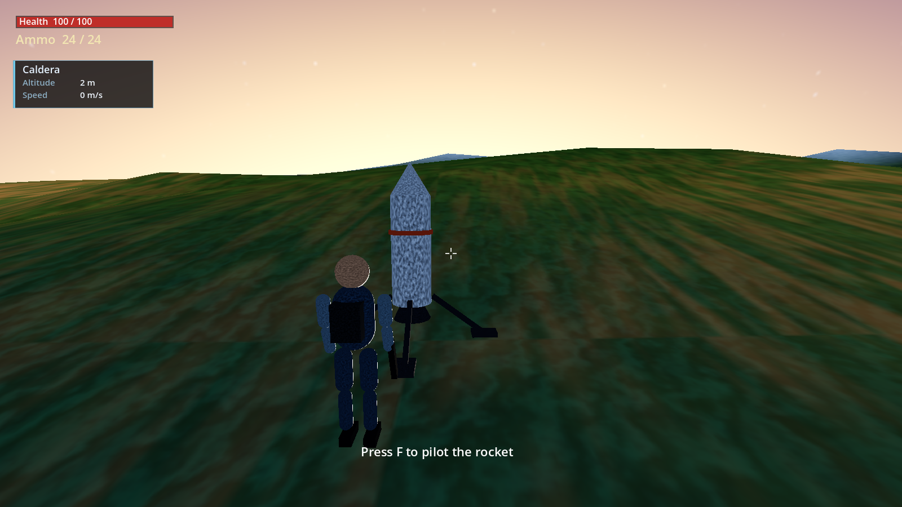
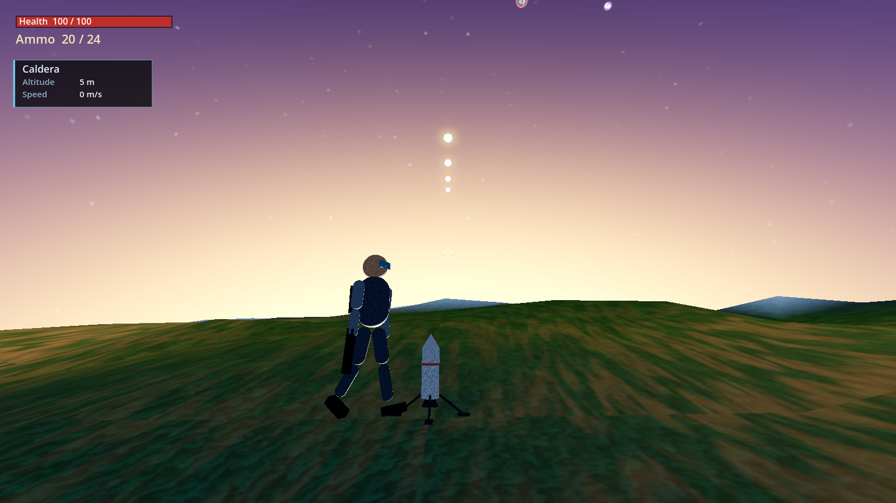
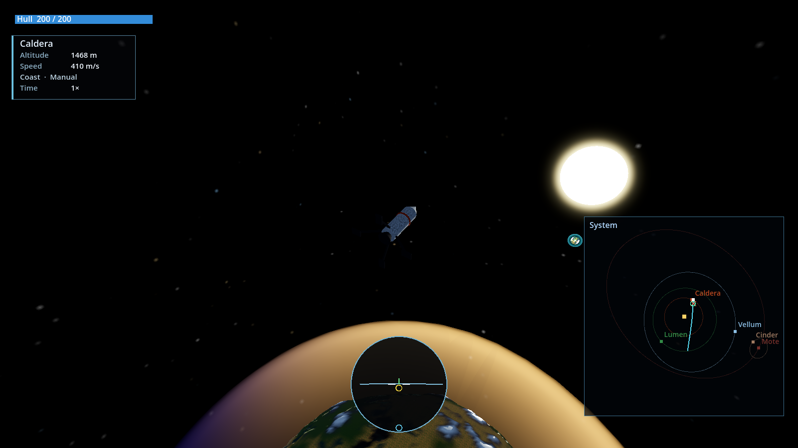
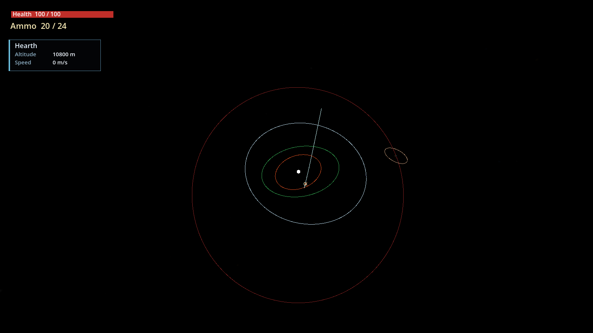
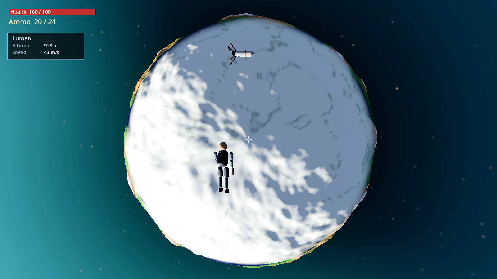
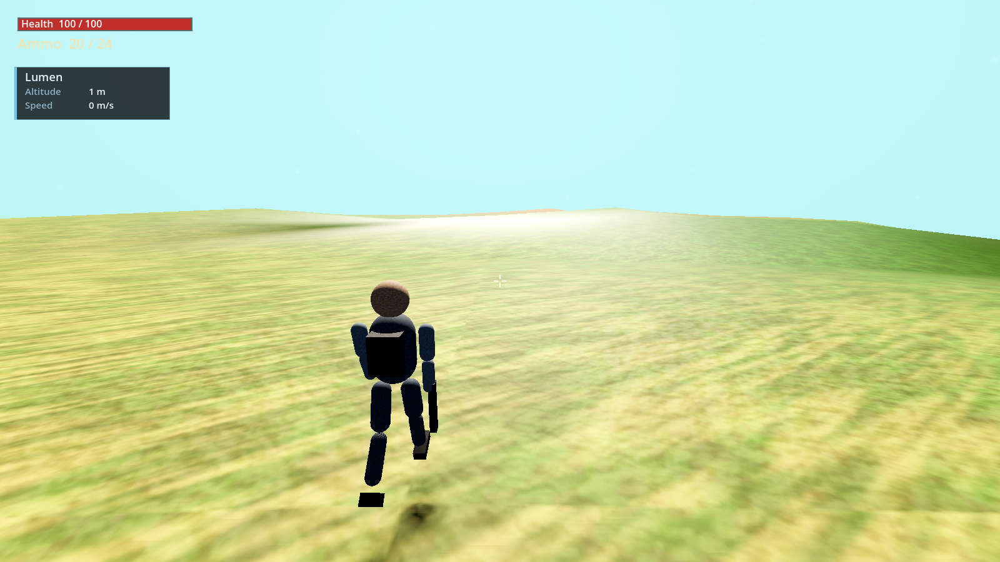
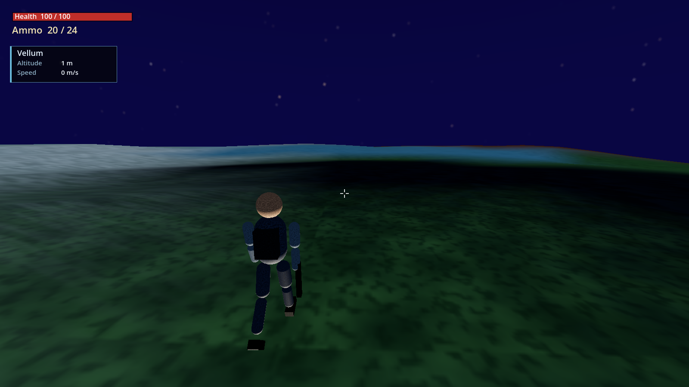
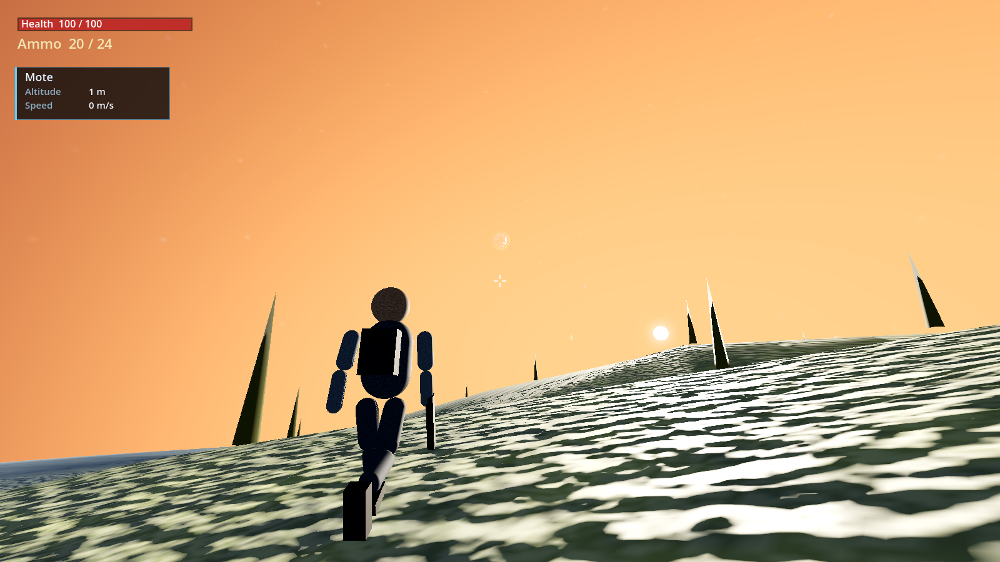

# Archipelag

A small 3D star system made to practice Godot and working with AI coding tools. Planets travel on fixed ellipses. The person on the ground and the rocket fall under gravity.

Requires [Godot 4.7](https://godotengine.org/) with the Forward+ renderer.

## What you can do

You start on **Caldera**, next to a landed rocket. Walk the surface, leave it with the suit, and fly the rocket to the other worlds. Getting too close to the star burns the suit and the hull. A fatal fall, a crash, or flying into the star ends the run and returns you to the menu.

**On foot**

- Third-person walk and sprint on the curved surface, with the body carried by the planet as it orbits and spins.
- Jump. Holding jump after you leave the ground fires a weak suit thruster, enough to climb off the world.
- Once airborne, steer in any direction. Gravity, atmosphere, and the planet’s motion still apply. Landing too hard costs health.
- Aim and fire a sidearm. Shots inherit your velocity, including the planet’s, and fall under gravity. Reload when the magazine is empty.
- Board the rocket when you are close enough.

**In the rocket**

- Pitch, yaw, and roll, then burn along the nose. The camera orbits the hull and zooms.
- Hold prograde or retrograde so the nose stays aligned with your velocity relative to the body that pulls hardest.
- Land on the legs. The ship freezes to the surface and rides with the planet until you lift off again.
- Speed up time at 1×, 2×, 4×, or 8× while you are flying. Time returns to normal on foot, in a menu, or when the ship is destroyed.

**The map**

- A corner map, or a large one, shows the star, each orbit, and where the rocket is headed if it coasts.
- The prediction is drawn in the frame of whichever body pulls hardest. Crosses mark leaving that frame; rings mark entering another.
- A yellow diamond marks a predicted impact. A navball under the ship shows the horizon, prograde, retrograde, and the local up and down.

## Screenshots

Frames from a running game. `tools/capture_shots.gd` can take them again.

On Caldera, next to the landed rocket.



Firing into the sky. The rounds are the bright dots above the crosshair.



Coasting above Caldera. The corner map draws the predicted path in cyan, and the navball sits under the ship.



The system map: orbits around Hearth, Cinder’s loop around Mote, and the rocket’s coast leaving Caldera.



Out of the rocket above Lumen.



Lumen.



Vellum.



Mote, with Cinder in the sky.



## The system

The star is **Hearth**. Four planets orbit it, and one moon orbits the outermost planet. Each world has its own radius, surface gravity, spin, atmosphere, and terrain seed.

| Body | Role |
| --- | --- |
| Hearth | The star. Source of gravity and of the heat that damages you nearby. |
| Caldera | Inner world. The run starts here. |
| Lumen | Second planet. |
| Vellum | Third planet. |
| Mote | Outer planet. |
| Cinder | Moon of Mote. |

Orbits are Keplerian ellipses: semi-major axis, eccentricity, inclination, and a spin rate. Position at any time comes from solving Kepler’s equation, so the planets stay on rails. The player, the rocket, and bullets do not. They integrate gravity from the star and every planet and moon, with drag inside an atmosphere. Inside a body, gravity falls off toward the center.

Terrain is a noisy sphere. Height, moisture, and a lake mask pick plains, desert, ice, ocean, lakes, and mountains, each with its own palette. A terrain shader, a simpler distant mesh, and instanced plants cover the surface. An atmosphere shell tints the limb and sets how thick the air is for drag. A starfield sky sits behind the system.

Sound is synthesized in the engine: a drone that changes between the menu, the ground, the air, and space, plus one-shot tones for the interface, footsteps in the air, shots, and the rocket’s burn.

## Controls

| On foot | |
| --- | --- |
| Mouse | Look |
| W A S D | Move |
| Shift | Sprint |
| Space | Jump, then suit thrust |
| Right mouse | Aim |
| Left mouse | Fire |
| R | Reload |
| F | Board the rocket |
| M | System map |
| Esc | Pause |
| F1 | Controls |

| Rocket | |
| --- | --- |
| Mouse | Camera |
| Wheel | Zoom |
| W / S | Nose down / nose up |
| A / D | Yaw |
| Q / E | Roll |
| Space | Thrust |
| P | Hold prograde |
| R | Hold retrograde |
| , / . | Slower / faster time |
| F | Leave the rocket |
| M | Map |
| Esc | Pause |
| F1 | Controls |

The same lists are on the Controls screen in the game.

## Layout

```
scenes/main.tscn          Entry scene. The system builds itself from code.
scripts/star_system.gd    Clock, gravity, drag, star heat, map camera, menus.
scripts/space_math.gd     Orbits, integration, and shared materials.
scripts/planet_body.gd    Terrain, biomes, plants, atmosphere, surface queries.
scripts/player.gd         Walking, suit flight, and the gun.
scripts/rocket.gd         Flight, landing, and the coast prediction.
scripts/hud.gd            Health, flight card, map, and navball.
scripts/menu.gd           Title, pause, controls, and the death screen.
shaders/                  Terrain, atmosphere, and the starfield sky.
tools/capture_shots.gd    Poses the game and writes the frames in screenshots/.
```

## License

[MIT](LICENSE). Copyright 2026 Denys Malovanyi.
